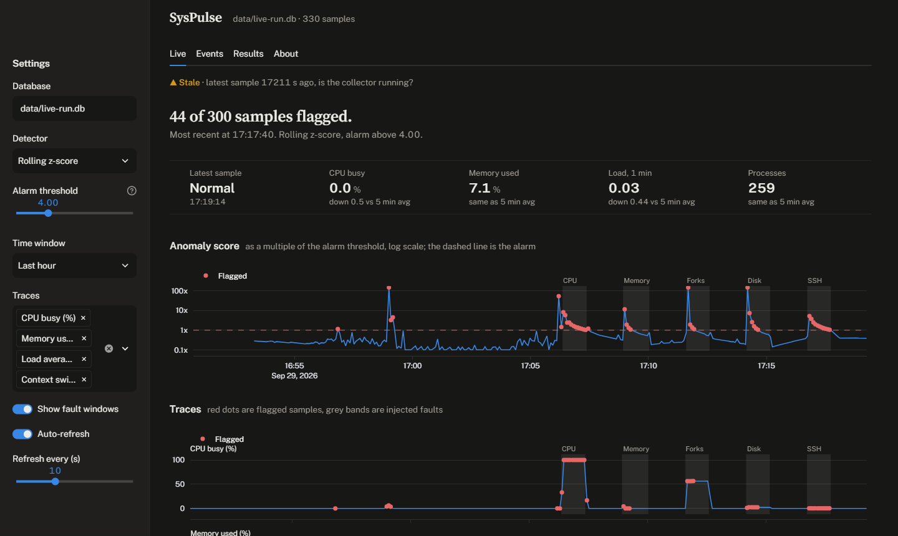
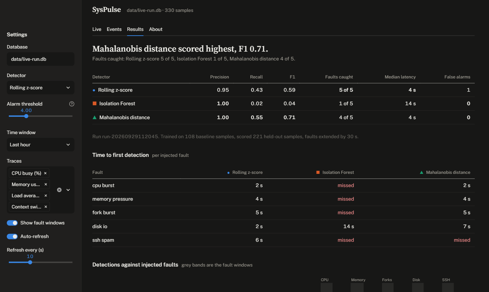

# SysPulse

Anomaly detection for a Linux host, measured against faults I inject on purpose. A C collector samples `/proc` into SQLite, a Python pipeline scores three detectors against recorded ground truth, and a Streamlit dashboard shows what was caught and what was missed.

| Live | Results |
|---|---|
|  |  |

## What it covers

**Linux and Unix**
- C11 collector reading `/proc` every 5 seconds: CPU, memory, disk, network, load, context switches, forks. As a systemd service it uses about 0.07% of one core and 3.4 MB.
- systemd service and timer, and a journald parser for failed SSH logins and OOM kills.
- Fault injection with `stress-ng` and `logger`, plus Bash, Make and Docker.

**Data science**
- Rolling-window features in pandas, free of lookahead and aware of sampling gaps.
- Three detectors compared: rolling z-score, Isolation Forest, and Mahalanobis distance with Ledoit-Wolf shrinkage.
- Scored on held-out samples with precision, recall, F1, detection latency and false-alarm runs, over three live runs.

## Results

F1 from three live runs of the same 28-minute fault scenario:

| Detector | Run 1 | Run 2 | Run 3 |
|---|---|---|---|
| Rolling z-score | 0.59 | 0.56 | 0.55 |
| Isolation Forest | 0.04 | 0.68 | 0.59 |
| Mahalanobis distance | 0.71 | 0.74 | 0.65 |

No detector wins outright. Mahalanobis had the best F1 each time but its precision fell to about 0.5 in later runs. The z-score is the most stable and the most conservative. The Isolation Forest failed once and then worked, so its alarm threshold looks fragile.

Runs 2 and 3 were compromised (the laptop slept during one, other work ran during the other) and the faults are synthetic. Read this as a demonstration of the method, not a benchmark. Details: [docs/RESULTS.md](docs/RESULTS.md).

## Run it

Needs Linux with systemd, or WSL2 with systemd enabled.

```bash
make apt-deps          # build tools, SQLite headers, stress-ng
make test              # C unit tests, then pytest
make install-service   # collector service and log-parser timer
make dashboard         # http://localhost:8501
make inject            # 28-minute fault scenario, then prints the evaluation
```

`make demo` runs the whole pipeline on synthetic data with no root. `make docker-up` starts the collector and dashboard in containers.

## Layout

| Path | Contents |
|---|---|
| `collector/` | C collector and its parsing code, with unit tests |
| `syspulse/` | Python package: log parser, features, detectors, evaluation |
| `dashboard/` | Streamlit app |
| `scripts/` | fault injector, Isolation Forest ablation |
| `systemd/` | service and timer units |
| `data/` | the three recorded runs |
| `docs/` | see below |

## Documentation

- [docs/SUMMARY.md](docs/SUMMARY.md): what this is, what it found, and what was and was not verified.
- [docs/DESIGN.md](docs/DESIGN.md): architecture, data model, algorithms, decisions and their trade-offs.
- [docs/RESULTS.md](docs/RESULTS.md): the three runs in full, with method and caveats.
- [docs/FAQ.md](docs/FAQ.md): plain-language questions and answers, also the About tab in the dashboard.

## Tests

76 C checks and 85 pytest tests, including integration tests that run the real collector binary against fixture `/proc` files. CI runs lint, the tests with a 90% coverage floor, systemd unit validation and a Docker build.

## Limits

- One machine, synthetic faults, short runs.
- No retention policy: the database grows about 8.5 MB a day.
- The dashboard has no authentication, so do not expose its port.

## License

MIT.
