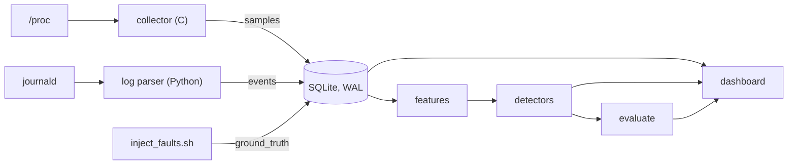

# SysPulse: design

## 1. Goals and non-goals

**Goals**
- Sample a Linux host cheaply and continuously, and keep the history queryable.
- Flag abnormal behaviour with more than one method, behind one interface.
- Measure each method against ground truth, so "does it work" has a number.
- Run as an ordinary service (systemd) and as a container, and be testable without root.

**Non-goals**
- Multi-host collection, alert delivery, or authentication. This watches one machine and shows its own dashboard.
- Replacing a production monitoring stack. The point is the full loop, including measuring accuracy.

## 2. Architecture

| Component | Language | Responsibility | Runs as |
|---|---|---|---|
| `collector/` | C11 | Read `/proc`, compute rates, insert one row per tick | systemd service |
| `syspulse/logparser.py` | Python | Classify journal entries, insert events | systemd timer, every minute |
| `syspulse/features.py` | Python | Rolling-window feature frame | library |
| `syspulse/detectors.py` | Python | Three detectors, one interface | library |
| `syspulse/evaluate.py` | Python | Label samples from ground truth, compute metrics | CLI and library |
| `scripts/inject_faults.sh` | Bash | Run the fault scenario, record its windows | on demand |
| `dashboard/` | Python | Present live data, events and results | Streamlit |

The database is the only interface between components. The collector, the parser and the fault injector never call each other, and each can be restarted independently. Detection is not a daemon: scoring a few thousand rows takes well under a second, so it runs on demand inside the dashboard and the evaluator.

## 3. Data model

One SQLite file in WAL mode, so the dashboard can read while the collector writes.

| Table | Key columns | Notes |
|---|---|---|
| `samples` | `ts` (primary key), 16 metric columns | One row per tick. `ts` is Unix seconds as a float. |
| `events` | `ts`, `kind`, `message`, unique on all three | `kind` is `ssh_fail` or `oom_kill`. The unique key makes re-ingesting harmless. |
| `ground_truth` | `run_id`, `label`, `start_ts`, `end_ts`, `is_fault` | Baseline and recovery phases are recorded too, with `is_fault = 0`. |
| `anomalies` | `ts`, `detector`, `score`, `is_anomaly` | Optional persisted scores. |

The `samples` DDL exists in two places, the C collector and `syspulse/db.py`. A test builds a database with the collector binary and asserts the column list matches the Python definition, so the copies cannot drift silently.

## 4. Collector

**Reads.** `/proc/stat`, `meminfo`, `loadavg`, `diskstats`, `net/dev`, and `statvfs("/")`.

**Rates from deltas.** CPU, disk, network, context switches and forks are counters, so each row is computed from the difference between two snapshots divided by the elapsed monotonic time. A counter that goes backwards (reboot, wrap) contributes zero instead of a huge unsigned value.

**Details that matter**
- CPU busy is `(total - idle - iowait) / total`, with I/O wait reported separately.
- Memory uses `MemAvailable`, with a fallback to `MemFree + Buffers + Cached` on old kernels.
- Disk throughput counts whole disks only (`sd*`, `vd*`, `xvd*`, `hd*`, `nvme<n>n<m>`, `mmcblk<n>`), so partitions and device-mapper layers are not double counted. Loopback is excluded from network.
- Ticks are scheduled against absolute deadlines with `clock_nanosleep`, so per-tick work does not accumulate drift.
- SIGTERM and SIGINT end the loop, then the statement is finalised and the WAL is checkpointed.

**Failure handling.** A failed `/proc` read skips the tick and keeps the previous snapshot, so the next rate spans the gap correctly. Inserts retry on a busy database after a 10-second busy timeout.

**Testability.** `--proc-root DIR` points the collector at a fixture directory, and `--once` writes one row and exits. That allows integration tests against known inputs without root and without depending on the host.

**Cost.** Measured on the installed service: about 0.07% of one core, 3.4 MB resident, one thread, about 490 bytes per row.

## 5. Log parser

- One `journalctl -o json` query with OR-ed match groups: `sshd`, `sshd-session`, kernel messages, and `systemd-oomd`.
- Failed SSH logins are matched by pattern (failed password or key, invalid user, authentication failure), and only when the entry comes from an SSH program. OOM kills are matched on the kernel and `systemd-oomd` messages, and the follow-up summary line is deliberately ignored so one kill is not counted twice.
- **Cursor semantics.** The cursor is written only after the insert has committed, with an atomic rename. A crash between the two re-reads a few entries, and the unique key on `events` absorbs the duplicates. A failed write never advances the cursor.
- Non-UTF-8 messages, which journald emits as byte arrays, are decoded rather than dropped.

## 6. Features

Computed per sample from the past only. For each of 17 signals (15 metrics plus the SSH and OOM counts over the trailing 60 seconds):

| Feature | Meaning |
|---|---|
| value | the reading itself |
| mean and std over 60 s | short-window level and volatility |
| mean and std over 300 s, excluding the current sample | the baseline, so a spike never dilutes its own baseline |
| value minus the 300 s mean | deviation from baseline |

Window lengths are derived from the median sampling interval, not hard-coded.

- **No lookahead**, enforced by a test that truncates the series and checks earlier rows do not change.
- **Sampling gaps.** A step longer than three times the interval means the machine slept or paused. Rolling windows that span it would mix before and after, and the first rate after it averages the whole pause. Every feature is set to NaN for one long window after a gap, and detectors skip those rows.

## 7. Detectors

All three implement `fit(clean_frame)` and `score(frame)`, returning a score and a flag per row, with NaN scores never flagged.

| Detector | Score | Trained | Notes |
|---|---|---|---|
| Rolling z-score | largest absolute z over all signals, against the trailing 300 s | no | The standard deviation is floored (5% of the mean, or an absolute minimum) so quiet signals cannot divide by zero. Threshold 4. |
| Isolation Forest | isolation-based anomaly score | yes | 200 trees on 68 features (value, both short-window stats and the deviation for 17 signals). |
| Mahalanobis distance | distance from the clean baseline | yes | Log-compressed, standardised values of the 17 signals under a Ledoit-Wolf shrunk covariance. |

**Why three.** They fail differently. The z-score adapts, so it reacts fast but forgets. The forest asks whether a point lies outside the range it has seen, and does not measure how far outside. Mahalanobis uses the size of the deviation and accounts for signals that move together. Comparing them on the same faults is the experiment.

**Thresholds for the trained detectors.** Clean rows are split in time order. The first 75% fit the model. The last 25% were never seen by it, and a high quantile of their scores sets the alarm. Setting it from the training rows themselves would be optimistic and would over-flag. The threshold is the larger of the two quantiles.

**Why Ledoit-Wolf.** There are a few dozen training rows and 17 correlated signals. The raw covariance is unstable in that regime, and shrinkage keeps the distance well behaved.

## 8. Evaluation

**Scenario.** 15 minutes of idle baseline, then CPU burst, memory pressure, fork burst, disk I/O and fake SSH login spam for 60 seconds each, with 90 seconds of recovery after each. SSH spam uses `logger -t sshd`, so real journal entries flow through the real parser without needing an SSH daemon.

**Split.** Detectors train on the first 60% of the baseline. The remainder of the baseline and everything after it is held out.

**Labels.** A sample is truly anomalous inside a fault window extended by 30 seconds, because rolling features keep reacting briefly after a fault stops. The 30 seconds is an assumption and applies to every detector equally.

**Metrics.** Per-sample precision, recall and F1. Per fault: was it caught at all, and seconds to the first flag. False-alarm runs are contiguous stretches of flags outside every fault window.

**Fairness.** Every detector is scored on the same rows: those where all of them have a score.

**Threats to validity.** One machine, synthetic faults, short runs, and only three of them, two compromised. The evaluation code is deterministic and tested on hand-built cases, so the arithmetic is not the risk. The data is.

## 9. Dashboard

- **Data flow.** The app loads the database, builds features, fits the detectors and scores everything. That is cached, keyed by the database path and a cheap fingerprint of its row counts and newest timestamp, so it recomputes only when data changes.
- **Refresh.** The Live tab is a Streamlit fragment that reruns on a timer alone, so the other tabs do not flicker.
- **Status.** Live means the newest sample is under 20 seconds old, stale means older, recorded means hours old. Each has its own symbol and a word, so state never rests on colour alone.
- **The score chart.** Each detector's score is plotted as a multiple of its own alarm threshold on a log axis, so one detector's raw scale (a z-score can reach the thousands) does not flatten the rest. The alarm is 1 for every detector.
- **Reference run.** When the viewed database has no events or no fault-injection run, those tabs show the bundled recorded run, with a note. That database is only ever opened read-only.
- **UI construction.** HTML fragments are pure functions in `components.py`, unit-tested and escaped. Streamlit's sanitizer strips inline SVG, so there is none. Dark is the only theme and is set in configuration.

## 10. Deployment

- **systemd.** The collector service restarts on failure, owns its state directory, and drops privileges: no new privileges, read-only filesystem except its state directory, private temp, no home access, an empty capability set. The parser is a oneshot service triggered by a timer and joins the `systemd-journal` group to read the journal. Templates are filled in by `make install-service`, and the units are validated with `systemd-analyze verify`.
- **Docker.** A multi-stage build compiles the collector and runs its unit tests, then copies the binary into a slim Python image that runs as an unprivileged user. Compose runs the collector and the dashboard sharing a volume, plus a demo profile.
- **Container caveat.** Inside a container `/proc` describes the host, and the journal is not available, so the log parser only runs in the systemd install.

## 11. Testing

| Layer | What it covers |
|---|---|
| C unit tests (76 checks) | Parsers, disk-name filter, rate math, counter resets, zero intervals |
| Python unit tests | Log classification, cursor safety, features and lookahead, gap handling, detectors, metric arithmetic |
| Integration | The real collector binary against fixture `/proc` files: values, schema match, WAL mode, bad input, clean SIGTERM |
| UI | Streamlit `AppTest` renders every state, the reference fallback, and read-only safety; component tests check escaping and symbols |
| CI | Lint, all of the above with a 90% coverage floor (96% measured), systemd unit validation, Docker build |

## 12. Decisions and trade-offs

| Decision | Alternative | Why |
|---|---|---|
| C for the collector | Python | It runs continuously on the host it watches, so cost matters, and it is a good place to learn `/proc`. |
| SQLite in WAL mode | Postgres, time-series database | One file, no server, concurrent reader and writer, and ample for one row every 5 seconds. |
| Database as the only interface | Queue or RPC | Components restart independently and can be inspected with plain SQL. |
| Detection on demand | A detector daemon | Scoring is cheap, and a daemon would add state to keep consistent. |
| Rolling-window features, no model of seasonality | A seasonal or learned time-series model | Runs are minutes long, so there is no seasonality to learn. |
| Compare three detectors | Pick one | The comparison is the result. It showed no single winner. |
| Report compromised runs | Rerun until clean | Discarding runs that disagree would hide the fragility that is the finding. |
| Dark theme only | Light and dark | One well-checked design beats two half-checked ones. |

## 13. Failure modes

| Failure | Behaviour |
|---|---|
| `/proc` read fails | Tick skipped, previous snapshot kept, next rate spans the gap |
| Database busy | Busy timeout, then retries, then an error on stderr and the tick is dropped |
| Machine sleeps or VM pauses | Features blanked for five minutes after the gap |
| Parser crash mid-batch | Cursor not advanced, duplicates absorbed by the unique key |
| Too little clean data | Trained detectors report they are still learning, and the traces keep updating |
| Database missing or empty | The dashboard says so and how to fix it |
| Counter reset or wrap | That interval contributes zero |

## 14. Limitations and future work

- No retention policy: the database grows about 8.5 MB a day, roughly 3 GB a year.
- Detectors are trained once from the start of the data, not retrained continuously.
- Recovery periods produce false alarms because the trailing baseline still contains the fault. Excluding a cool-down window from the baseline is the obvious next step.
- The z-score and Mahalanobis scores miss different faults, so combining them is worth trying.
- A clean, longer, idle benchmark run is still owed, and more runs would give confidence intervals.
- No authentication on the dashboard.
